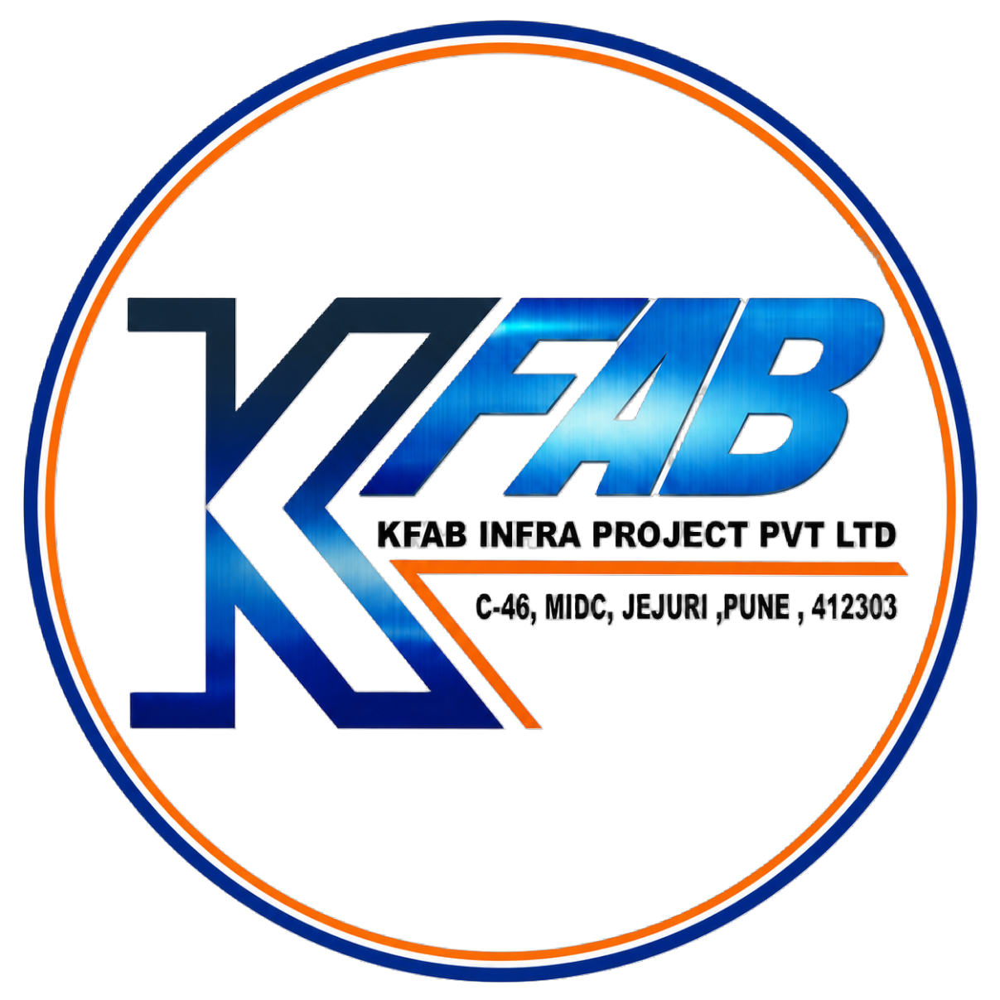
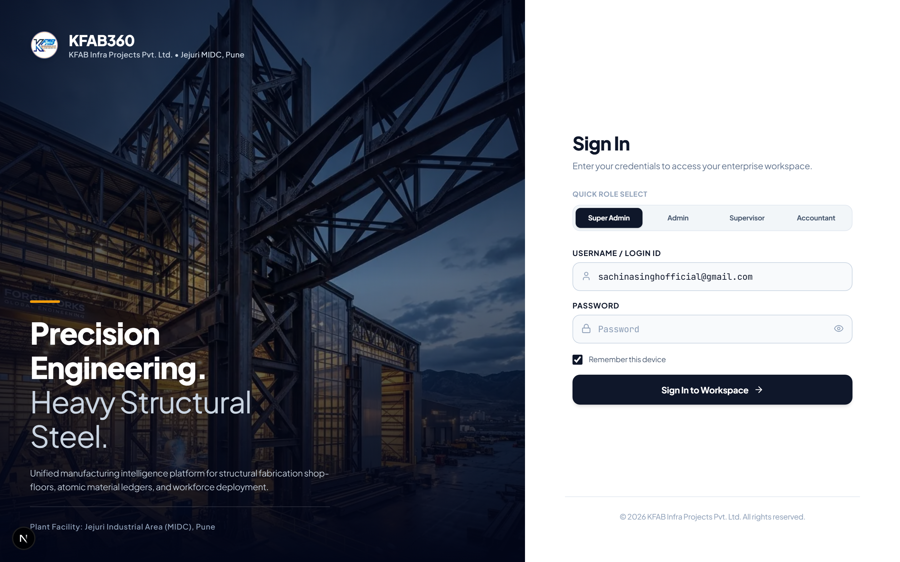
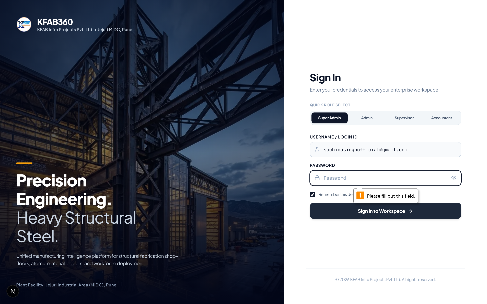
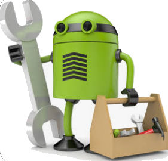

# KFAB360 — Enterprise Operations & Shop-Floor ERP

<p align="center">
  
</p>

<p align="center">
  <strong>Unified Heavy Steel Fabrication ERP & Manufacturing Intelligence Platform</strong><br>
  Built for shop-floor tracking, atomic material ledgers, workforce muster attendance, and plant operations.
</p>

<p align="center">
  
  
  
  
  
  
</p>

---

## 🌟 Overview

**KFAB360 (KFAB Basic)** is a full-stack, enterprise-grade Industrial Operations and ERP system engineered specifically for **heavy structural steel fabrication plants, PEB (Pre-Engineered Building) manufacturers, and industrial engineering facilities**.

The system bridges the executive office with the shop-floor, enabling real-time coordination across welding bays, raw steel inventory stocks, daily biometric/muster roll attendance, and financial ledgers.

---

## 📸 System Screenshots

### 1. Executive Multi-Role Authentication
> *Streamlined, enterprise login screen with 1-click role profile selection (Super Admin, Admin, Supervisor, Accountant) and corporate brand theming.*

<p align="center">
  
</p>

---

### 2. Executive Operations & KPI Dashboard
> *Real-time shop-floor operational pulse: active structural projects, revenue analytics, bay production throughput, inventory status, and plant announcements.*

<p align="center">
  
</p>

---

### 3. Team Chat & Plant Channels
> *Integrated technician communication with our custom 3D Mechanic Android Bot companion. Features interactive coffee speed-boosting and playful telemetry updates.*

<p align="center">
  
</p>

---

## 🏗️ Architecture & Technology Stack

The platform is designed as a unified monorepo connecting web and mobile clients to a synchronized cloud backend:

```
                                ┌──────────────────────────────────────────────┐
                                │          SUPABASE (Cloud Backend)            │
                                │  https://rpskidjmetjhadghpntl.supabase.co    │
                                │  • PostgreSQL 15+    • Row Level Security    │
                                │  • Realtime Engine   • Supabase Auth (JWT)   │
                                └──────────────────────┬───────────────────────┘
                                                       │
                     ┌─────────────────────────────────┴─────────────────────────────────┐
                     │                                                                   │
                     ▼                                                                   ▼
      ┌──────────────────────────────┐                                    ┌──────────────────────────────┐
      │      KFAB-WEB (Next.js)      │                                    │     KFAB-MOBILE (Flutter)    │
      │      Deployed on Vercel      │                                    │      Android / iOS Apps      │
      │   • React 19 / Turbopack     │                                    │   • Flutter 3.x / Dart 3     │
      │   • TailwindCSS v4           │                                    │   • Offline-first Cache      │
      │   • Glassmorphic UI Tokens   │                                    │   • Biometric & Camera QA    │
      └──────────────┬───────────────┘                                    └──────────────┬───────────────┘
                     │                                                                   │
                     └─────────────────────────────────┬─────────────────────────────────┘
                                                       │
                                                       ▼
                                        ┌──────────────────────────────┐
                                        │    KFAB-BACKEND (Fastify)    │
                                        │    Node.js Microservice      │
                                        │   • Rate Limiting & Helmet   │
                                        │   • Strict RBAC Middleware   │
                                        │   • Audit Trail Logging      │
                                        └──────────────────────────────┘
```

| Layer | Technology | Key Highlights |
|---|---|---|
| **Web Client** | Next.js 16 (App Router) + React 19 | SSR/SSG, Turbopack, Lucide Icons, Excel (.xlsx) export engine |
| **Mobile Client** | Flutter 3.x (Dart) | Cross-platform (Android APK / iOS), native camera for weld inspection |
| **Backend API** | Fastify 5 + Node.js + TypeScript | Zero-overhead framework, Zod validation, Helmet security headers |
| **Database** | PostgreSQL via Supabase | Row-Level Security (RLS), real-time WebSockets, automated backups |
| **Styling** | Vanilla CSS + TailwindCSS v4 | Executive slate/dark themes, responsive grid, micro-animations |

---

## ⚡ Core Modules

### 1. 📊 Executive Operations Dashboard
- **Financial Performance**: Live monitoring of accounts payable, bill disbursements, and receivables.
- **Bay Utilization**: Real-time status of Cutting, Fit-up, Welding, Shot-Blasting, and Painting lines.
- **Issue Dispatch**: Instant incident ticketing for machine breakdowns or material shortages.

### 2. 📦 Atomic Material & Stock Ledger
- **Raw Material Tracking**: Structural plates, universal beams (UB/UC), channels, angles, and hollow sections.
- **Heat Number Traceability**: Mill test certificates (MTC) linked to inward delivery challans.
- **Voucher Operations**: Inward GRN (Goods Receipt Note), Shopfloor Issue Vouchers, and Scrap/Return slips.

### 3. ⏱️ Workforce Muster Roll & Attendance
- **Daily Muster**: Real-time punch-in/out records for welders, fitters, riggers, and crane operators.
- **Overtime & Shift Management**: Automatic calculation of OT hours based on plant shift policies.
- **Muster Grid & Excel Sync**: Single-click bulk export and import compatible with corporate payroll systems.

### 4. 👥 Role-Based Access Control (RBAC)
- **Multi-Role Scopes**: `SUPER_ADMIN`, `ADMIN`, `SUPERVISOR`, `ACCOUNTANT`, `STOREKEEPER`, `ATTENDANCE_USER`.
- **Granular Permissions**: Restrict financial figures, audit logs, and employee deletion based on operational hierarchy.

### 5. 💬 Team Communication & Bay Channels
- **Bay-Specific Channels**: Dedicated discussion threads for Bay 1 (Heavy Girders), Bay 2 (PEB Columns), etc.
- **Quality Photo Inspections**: Direct photo uploads for non-destructive weld testing (NDT/UT/MPI) and QA sign-offs.

---

## 📁 Repository Structure

```text
kfab-basic/
├── kfab-web/                # Next.js 16 Executive Web ERP
│   ├── src/
│   │   ├── app/             # Next.js App Router pages
│   │   ├── components/      # UI components (views, modals, tables)
│   │   └── lib/             # Supabase client, auth store, API helpers
│   └── public/              # Static branding assets & illustrations
│
├── kfab-mobile/             # Flutter Mobile Application
│   ├── lib/
│   │   ├── core/            # Models, state, app theme, Supabase config
│   │   ├── screens/         # Mobile screens (attendance, chat, stock)
│   │   └── widgets/         # Reusable mobile UI components
│   └── assets/              # App images, icons, and branding logos
│
├── kfab-backend/            # Fastify Node.js Enterprise API
│   ├── src/
│   │   ├── modules/         # Auth, users, attendance, inventory, audit
│   │   ├── middleware/      # RBAC permission checks, security headers
│   │   └── db/              # Supabase administrative connection
│   └── supabase/migrations/ # SQL schemas, RLS policies, seed profiles
│
└── docs/                    # Architecture diagrams, specifications, & assets
    ├── screenshots/         # High-resolution application screenshots
    └── DATABASE_DESIGN.md   # Complete PostgreSQL relational schema
```

---

## 🚀 Getting Started

### Prerequisites
- **Node.js**: `v20.x` or higher
- **npm** or **pnpm**
- **Flutter SDK**: `v3.x` (for mobile development)
- **Supabase Account**: (or local Supabase CLI instance)

---

### 1. Web Application (`kfab-web`)

```bash
cd kfab-web

# Install dependencies
npm install

# Start local Next.js development server
npm run dev
```

Open [http://localhost:3000](http://localhost:3000) in your browser.

#### Environment Variables (`kfab-web/.env.local`):
```env
NEXT_PUBLIC_SUPABASE_URL=https://rpskidjmetjhadghpntl.supabase.co
NEXT_PUBLIC_SUPABASE_ANON_KEY=eyJhbGciOi...
NEXT_PUBLIC_APP_ENV=development
```

---

### 2. Mobile Application (`kfab-mobile`)

```bash
cd kfab-mobile

# Fetch packages
flutter pub get

# Run on connected Android / iOS device or emulator
flutter run
```

---

### 3. Fastify Backend Server (`kfab-backend`)

```bash
cd kfab-backend

# Install dependencies
npm install

# Start development server with live reload
npm run dev
```

The Fastify server starts on `http://localhost:5000`.

---

## 🔐 Default Demo Credentials

For quick evaluation, use the pre-configured accounts below:

| Role | Username / Email | Password | Permissions Scope |
|---|---|---|---|
| **Super Admin** | `sachinasinghofficial@gmail.com` | `admin123` | Full enterprise control, user provisioning, security audits |
| **Admin** | `admin` | `admin123` | Plant operations, inventory management, attendance corrections |
| **Supervisor** | `supervisor` | `supervisor123` | Shopfloor bay updates, muster roll marking, material issue |
| **Accountant** | `accountant` | `accountant123` | Financial records, commercial invoices, bill disbursements |

---

## 🌐 Cloud Deployment

- **Web Frontend**: Ready for 1-click deployment on **[Vercel](https://vercel.com)**. Set Root Directory to `kfab-web`.
- **Database & Auth**: Hosted on **[Supabase Cloud](https://supabase.com)** with automated daily backups.
- **Mobile Release**: Build production Android APKs via `flutter build apk --release`.

---

## 🏢 Corporate Credits

**KFAB Infra Projects Pvt. Ltd.**  
*Plant Facility: Jejuri Industrial Area (MIDC), Pune, Maharashtra, India.*  
*Engineering Excellence in Heavy Structural Fabrication & Infrastructure Projects.*

&copy; 2026 KFAB Infra Projects Pvt. Ltd. All rights reserved.
